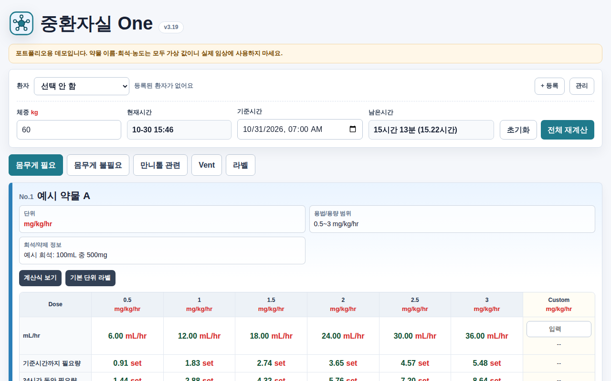
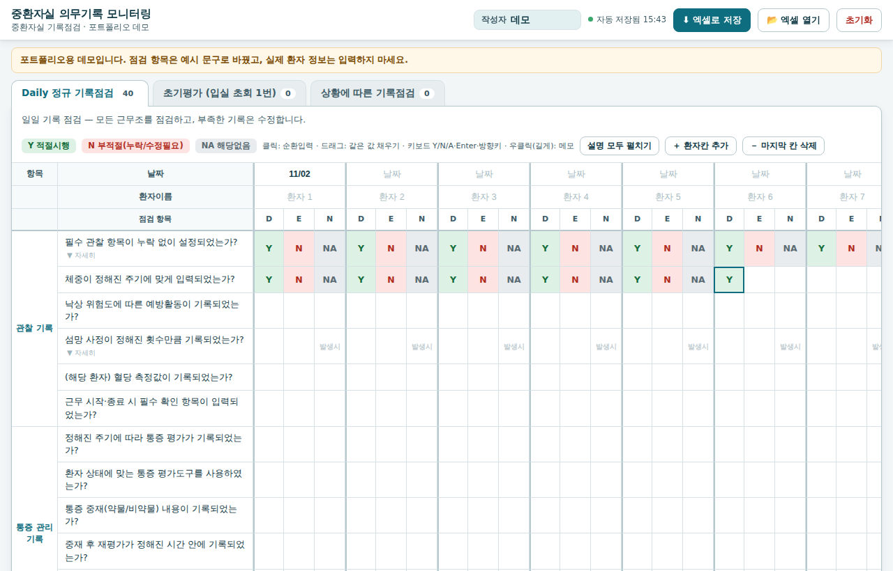
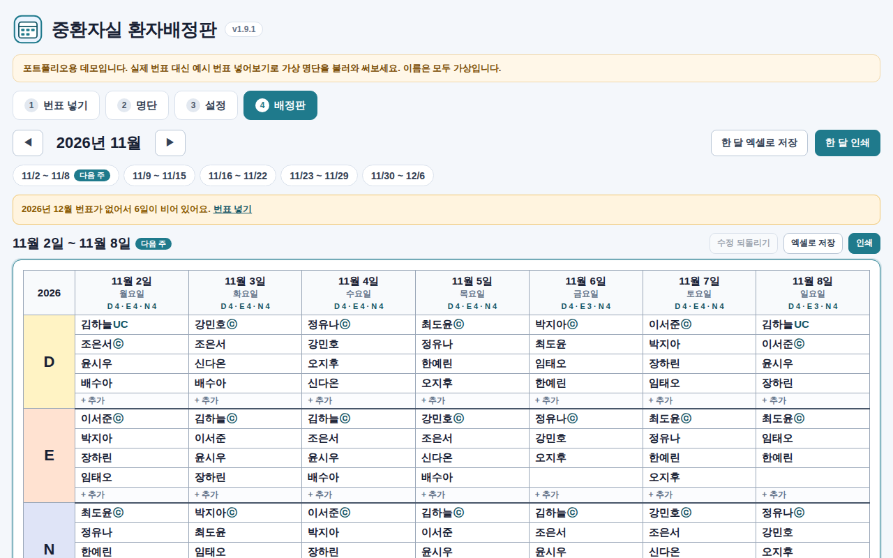

# 병동 도구 포트폴리오

신경계 중환자실 간호사로 일하며 병동에서 직접 만들어 쓰는 도구 3가지를 비식별화한 데모입니다.
근무마다 반복되는 계산, 기록 점검, 근무 배정을 브라우저에서 바로 열리는 단일 HTML 도구로 옮겼습니다.

**데모 페이지:** https://johnoh354.github.io/ward-tools/

> 이 저장소의 도구는 설계와 동작을 보여주기 위한 데모입니다. 실제 임상에 사용하지 마세요.

## 도구

### 중환자실 One

- **문제:** 약물 주입 속도, 만니톨 용량, 인공호흡기 설정값을 따로따로 계산하고, 라벨은 손으로 적었습니다.
- **하는 일:** 체중과 기준시간을 한 번 넣으면 약물별 주입 속도와 필요량을 함께 계산합니다. 만니톨, Osmol gap, IBW, P/F ratio, Cdynamic 계산과 인공호흡기 라벨 인쇄도 같은 화면에서 처리합니다.
- **설계:** 권장 범위를 벗어난 용량과 체중이 빠진 계산은 바로 경고하고, 라벨은 미리보기 그대로 인쇄됩니다. 병동에 배포해 사용 중입니다.
- **데모:** [tools/one](tools/one/) — 약물 이름, 희석, 농도는 모두 가상 값입니다.

### 의무기록 모니터링

- **문제:** 근무조별 기록 점검을 엑셀 표에 직접 입력하느라 칸을 놓치거나 잘못 넣기 쉬웠습니다.
- **하는 일:** 점검표를 화면으로 옮겨 클릭과 키보드(Y, N, A)로 빠르게 입력하고, 같은 값은 끌어서 채웁니다. 결과는 기존 제출 양식 그대로의 엑셀 파일로 저장하고, 다시 불러와 이어서 씁니다.
- **설계:** 화면의 칸과 엑셀 양식의 셀 위치를 하나하나 맞춰, 화면과 파일 사이에서 값이 어긋나지 않게 했습니다. 메모는 엑셀 셀 메모로 그대로 오갑니다.
- **데모:** [tools/record-monitor](tools/record-monitor/) — 점검 항목은 예시 문구로 바꿨습니다.

### 환자배정판

- **문제:** 매주 번표를 엑셀 매크로로 정리한 뒤, 배정판에 다시 옮겨 적어 공지했습니다.
- **하는 일:** 번표를 붙여넣거나 엑셀 파일로 넣으면 근무코드를 정리해 주간 배정판을 만듭니다. 차지와 프리셉터 표시, 이름 끌어서 옮기기, 인쇄와 엑셀 저장까지 처리합니다.
- **설계:** 번표마다 다른 근무코드를 규칙표로 바꿔 배정판의 Day, Evening, Night에 묶습니다. 손으로 고친 칸은 따로 표시해 자동 결과와 구분합니다.
- **데모:** [tools/assignment-board](tools/assignment-board/) — '번표 넣기'에서 **예시 번표 넣어보기**를 누르면 가상 명단으로 바로 써볼 수 있습니다.

## 공통 설계 원칙

- **파일 하나로 실행:** 병원 PC에 프로그램을 설치할 수 없어서, HTML 파일 하나만 열면 동작하게 만들었습니다.
- **데이터는 밖으로 나가지 않음:** 외부 서버와 통신하지 않고, 인터넷이 없어도 동작합니다. 입력 내용은 같은 PC의 브라우저에만 자동 저장됩니다.
- **기존 양식을 바꾸지 않음:** 현장에서 쓰던 엑셀 양식과 그대로 주고받습니다.
- **실수를 막는 장치:** 범위 경고, 두 번 눌러야 되는 초기화, 미리보기 후 인쇄, 손으로 고친 칸 표시.

## 비식별화

병원 이름, 직원과 환자 이름, 병원 고유의 약물 희석 기준과 처방코드, 내부 점검 문구, 파일 속 작성자와 프린터 정보는 모두 지우거나 가상 값으로 바꿨습니다.

## 실행

각 도구의 `index.html`을 브라우저로 열면 됩니다. 설치가 필요 없습니다.
